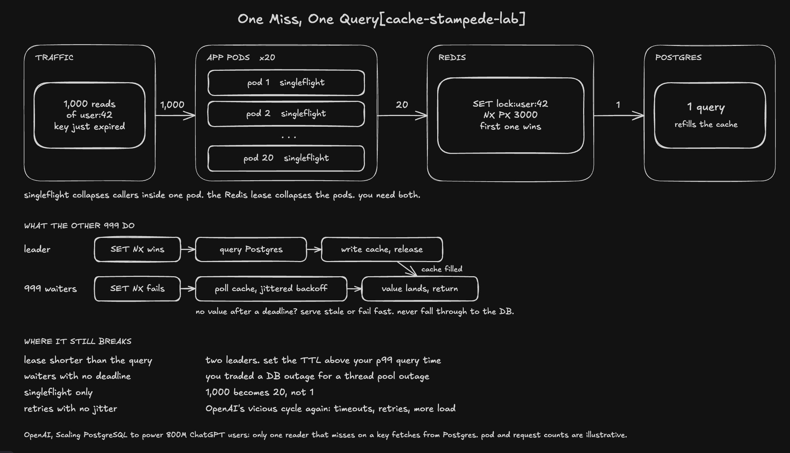

# Cache stampede lab

Go + Redis + PostgreSQL, with three application replicas behind Nginx, Prometheus metrics, an open-loop load generator, and charts from real measurements.



The diagram's counts are illustrative. This lab uses **three replicas and 2,000 RPS**, and fails when follower deadlines expire; it does not serve stale data. Inspired by [OpenAI's published cache-locking concept](https://openai.com/index/scaling-postgresql/); Go, Redis, and this implementation are our choices.

## Run

Requires Docker Compose, Go 1.23+, and Python 3.9+. Use `docker compose` if your installation uses the plugin.

```sh
docker-compose up -d --build
curl http://localhost:18080/items/1
```

Select a mode with `MODE=naive`, `MODE=singleflight`, or `MODE=lease` before `docker-compose up -d`. Prometheus: `http://localhost:19090`.

## Benchmark

```sh
python3 scripts/benchmark.py --rate 2000 --repeats 2 --failures \
  --docker-loadgen --output results/my-run
python3 scripts/report.py --input results/my-run
```

Measured with a **deliberate 200 ms PostgreSQL delay**, identical overload limits, and targeted hot-key deletion:

| Mode | DB reads per refill, both runs | Errors per 24,000 requests |
| --- | ---: | ---: |
| naive | 96 | 308 / 309 |
| singleflight | 3 | 0 / 0 |
| lease | 1 | 0 / 0 |

All six trials completed approximately 2,000 RPS with no generator drops. Naive mode's fast rejections make its overall p99 misleading; charts include errors and latency over time.

[Raw results and configuration](results/20261009-2000rps) · [Naive chart](results/20261009-2000rps/naive-1/charts.svg) · [Singleflight chart](results/20261009-2000rps/singleflight-1/charts.svg) · [Lease chart](results/20261009-2000rps/lease-1/charts.svg)

## Checks and limits

Formatting, `go vet`, tests, and the race detector passed with real Redis/PostgreSQL. All 13 benchmark runs completed, including distinct keys, cold data, killed owner, lease expiry, and Redis outage.

Leases reduce duplicate reads under healthy coordination; expiry or failover can allow overlapping queries. Publication and release check ownership atomically. Followers have deadlines and never bypass coordination on timeout. Redis outages fail closed. Per-key coordination does not remove database capacity limits.

[Detailed setup, architecture diagram, test commands, metrics, failure results, and limitations →](docs/guide.md)
