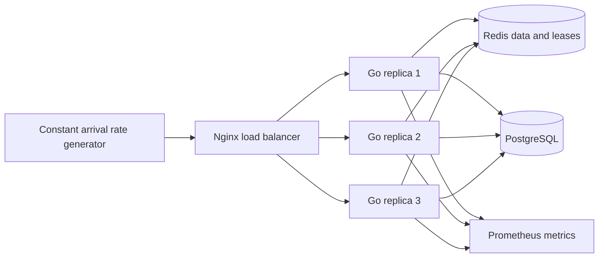

# Architecture and interpretation

This lab demonstrates the cache locking and leasing concept described in [OpenAI's PostgreSQL scaling article](https://openai.com/index/scaling-postgresql/): one reader refreshes a missing cache key while other readers wait. Go, Redis, these Lua scripts, the load balancer, and the overload settings are implementation choices for this prototype. This repository does not claim that OpenAI uses this stack or implementation.

All replicas use the same per-key Redis data cache and seeded PostgreSQL table. An HTTP read checks `data:<id>` before choosing its refresh path. A missing key and a Redis command failure are separate outcomes. Redis failures return an error; they do not redirect every request into PostgreSQL.

| Mode | Refresh coordination | Healthy hot-key refill expectation |
| --- | --- | --- |
| `naive` | Each request can start its own refresh | Duplicate queries, bounded by overload limits |
| `singleflight` | One shared refresh per key per process | Up to one concurrent query per active replica |
| `lease` | Local singleflight plus a shared Redis lease | Usually one concurrent query across replicas |

The local shared refresh rechecks the cache before querying PostgreSQL. Its lifetime is bounded by a service-owned context, separate from an individual caller's cancellation. Each caller also has its own bounded wait. A caller that stops waiting does not cancel work needed by other callers. Service shutdown cancels shared work and waits for it to finish.

In lease mode, a process attempts `SET lease:<id> <random-token> NX PX <ttl>`. A winner rechecks the data cache before querying. A Lua script publishes the refreshed data only if Redis still contains its ownership token. A separate Lua script releases the lease only if its token still matches. An expired owner therefore cannot overwrite a newer refresh or delete a replacement owner's lease on the same authoritative Redis instance. Followers poll with bounded exponential backoff and jitter and can compete again when an owner disappears. Exhausting a wait budget returns an error rather than bypassing coordination and querying PostgreSQL.

Every mode has the same configured PostgreSQL connection pool cap and nonblocking concurrent database fallback limit. This matters when comparing results: low endpoint latency can result from fast overload rejection. The charts therefore show errors, timeouts, generator drops, and offered/completed rates alongside endpoint p99 and database QPS. Database query starts are counted immediately before issuing the actual query, separately from attempted cache refreshes and rejected fallbacks. Pool acquisition wait and query duration have separate histograms.

## Load generator accounting

The generator schedules requests against absolute timestamps at a configurable offered arrival rate, defaulting to 2,000 requests per second. It does not wait for a response before scheduling the next offer. The `max-inflight` limit records excess offers as generator drops rather than silently slowing traffic. Scheduling lag exposes when the generator itself cannot dispatch on time. The raw request CSV includes scheduled, dispatched, and completed offsets, HTTP latency, scheduling lag, and offered-to-completion duration. Completion counts include HTTP and transport errors; these are also reported separately. Timeout counts are a subset of errors.

One-second series bucket offers by their scheduled time and completions by their actual completion time. HTTP latency percentiles include error responses. The final completion rate includes the response drain period. Raw Prometheus snapshots preserve all service counters and histograms. Database QPS is derived from valid adjacent summed replica counters; failed scrapes or counter resets produce gaps, never fabricated zero activity.

## Limits of the experiment

A Redis lease reduces duplicate reads under healthy coordination; it is not an unconditional exactly-once guarantee. Lease expiry permits a new owner to begin while an older query is still running. Redis failover or lost lease state can also permit overlapping refreshes. Token checks protect publication against a superseded owner on the current Redis instance; they do not provide durable fencing of arbitrary external side effects.

There is no lease renewal. When the simulated query duration consistently exceeds the lease, successive owners can all lose ownership before publishing, resulting in bounded errors and repeated reads instead of successful refill. Choose a lease longer than the normal query window, while retaining the short-lease scenario to demonstrate this limitation.

A lease coordinates one key, not total database demand. Many distinct missing keys still compete for finite database capacity and can be rejected. This prototype does not implement stale-while-revalidate, negative caching, adaptive admission, authentication, TLS, Redis Cluster key-slot routing, or a production failover topology. The main experiment removes only a selected `data:` key; clearing the data cache must preserve `lease:` keys.

The configurable PostgreSQL `pg_sleep` delay deliberately widens the refill window and consumes a connection during that window. Measurements with this delay are a reproducible simulation on the recorded local environment, not a production throughput benchmark. The load generator, replicas, cache, and database may share machine resources, and metrics scrapes have finite temporal resolution. Interpret database protection together with successful throughput, errors, scheduling lag, and actual achieved rates.
